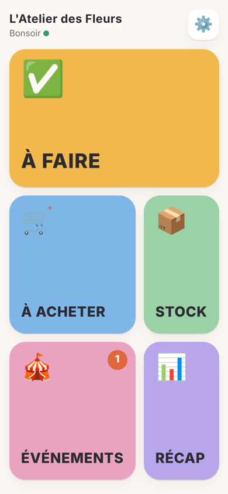
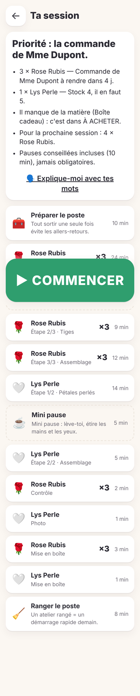
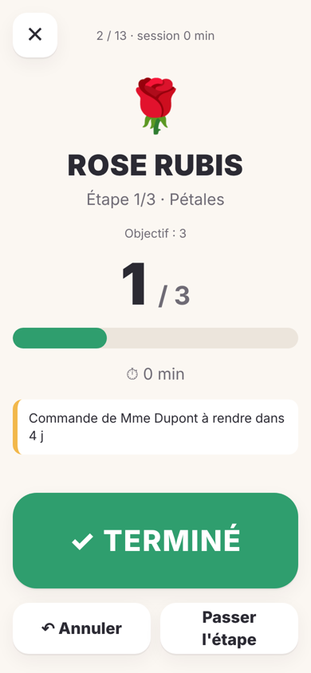
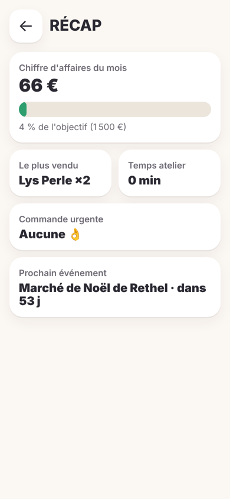

# BOSS IA

**Ton directeur d'atelier IA.** Le matin, tu ouvres l'application, tu touches **À FAIRE**, et elle te dit
*exactement ce que tu dois faire aujourd'hui, dans quel ordre, et pourquoi.* Toi, tu produis.

| Accueil | Plan du jour | Production | Récap |
|---|---|---|---|
|  |  |  |  |

- **5 gros boutons** : À FAIRE · À ACHETER · STOCK · ÉVÉNEMENTS · RÉCAP (+ Réglages).
- **À FAIRE** : 3 questions (temps, énergie, pauses) → session construite automatiquement depuis les commandes,
  événements, prévisions, stock, temps moyens réels, rentabilité et objectif du mois. Mode série, préparation
  groupée, pauses conseillées, gros bouton TERMINÉ, pas de compte à rebours.
- **À ACHETER** : besoins matière anticipés, budget, lien fournisseur, comparaison IA. Validation obligatoire.
- **STOCK** : − / +, changements en attente, résumé, « vendu ? » pour nourrir la mémoire des ventes.
- **ÉVÉNEMENTS** : recherche web, classement 🔥 / 👍 / 💤 expliqué, mémoire des années passées,
  candidatures préparées par l'IA, idées de reels / posts depuis tes vidéos d'atelier. Rien n'est envoyé sans toi.
- **RÉCAP** : 8 informations, aucun tableau.
- PWA installable, **100 % hors-ligne**, synchronisée entre PC, téléphone et tablette.

## Ouvrir sans rien installer

Télécharge **[BOSS-IA.html](BOSS-IA.html)** et ouvre-le d'un double-clic (Chrome, Edge, Firefox ou Safari).
Tout fonctionne directement, tes données restent dans ce navigateur. Pour régénérer ce fichier :
`npm run build:standalone -w @boss/web`.

## Démarrer (version complète : synchro multi-appareils + IA)

```bash
npm install
npm test            # tests du cerveau (@boss/core)
npm run build       # compile la PWA
cp .env.example .env   # puis renseigne BOSS_TOKEN (et ANTHROPIC_API_KEY pour les agents IA)
npm start           # serveur + PWA sur http://localhost:8787
```

Développement : `npm run dev:server` et `npm run dev` (Vite, proxy `/api` vers le serveur).

Au premier lancement, choisis « Voir avec un atelier d'exemple » pour découvrir l'app avec des données réalistes.

## Architecture

Voir [docs/ARCHITECTURE.md](docs/ARCHITECTURE.md).
`packages/core` (cerveau déterministe testé) · `apps/web` (PWA React + Dexie) · `apps/server` (Hono + SQLite + agents Claude).
