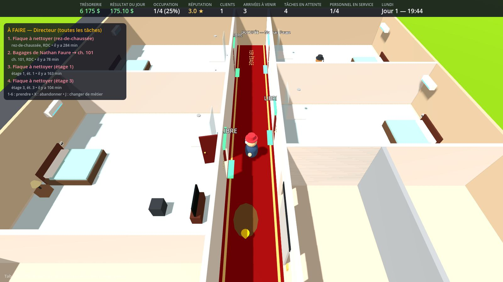
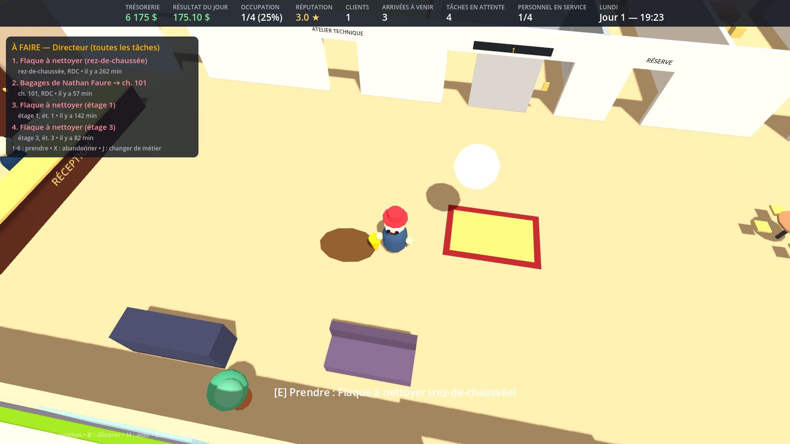
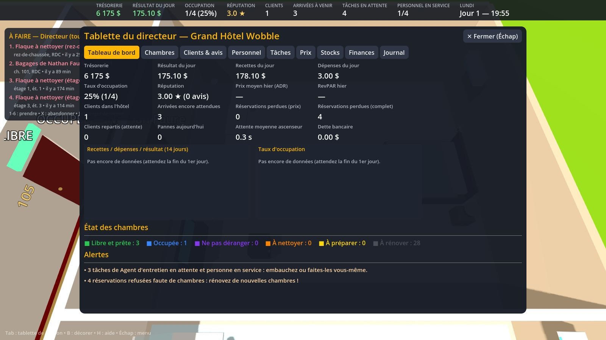
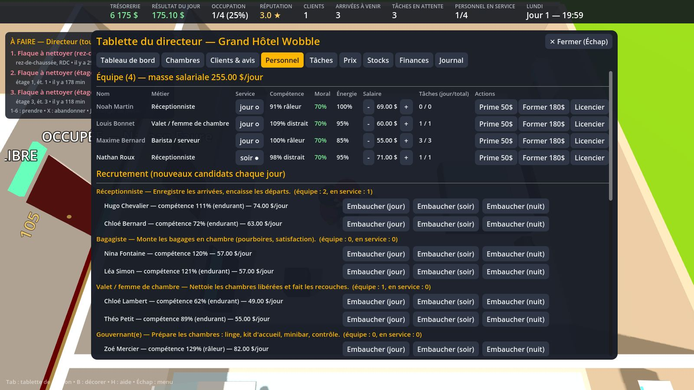
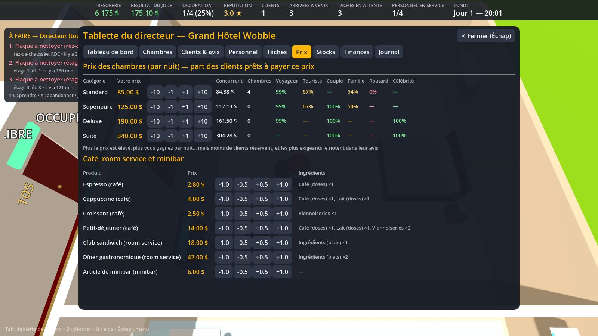

# Grand Hôtel Wobble

Dirigez un **hôtel de luxe de 5 niveaux** peuplé de bonshommes « wobbly » aux yeux globuleux. Vous êtes le directeur, mais vous pouvez aussi **faire vous-même n'importe lequel des 11 métiers** : accueillir les clients, monter les bagages, faire le ménage, préparer les chambres, réparer les télés et les prises, lancer la laverie, servir au café, cuisiner pour le room service, gérer la conciergerie, calmer les voisins bruyants la nuit…

> **Version 0.2, solo.** Elle remplace le prototype « Bourgade Inc. » (monde ouvert), qui reste dans l'historique Git (commit `672d169`).



| Lobby & liste « À faire » | Tableau de bord |
|---|---|
|  |  |
| **Personnel & recrutement** | **Tableau des prix** |
|  |  |

---

## Lancer le jeu (Windows)

1. Téléchargez [`releases/GrandHotelWobble-Windows-v0.2.zip`](releases/GrandHotelWobble-Windows-v0.2.zip) (≈ 33 Mo).
2. Décompressez-le **entièrement** (« Extraire tout… ») : `GrandHotelWobble.exe` et `GrandHotelWobble.pck` doivent rester ensemble.
3. Double-cliquez sur `GrandHotelWobble.exe`. Si Windows affiche « Windows a protégé votre ordinateur », cliquez sur *Informations complémentaires*, puis sur *Exécuter quand même* (l'exécutable n'est pas signé).

**Depuis les sources** : installez [Godot 4.4.1 Standard](https://godotengine.org/download/archive/4.4.1-stable/), puis *Importer* → `game/project.godot` → **F5**.

**Tests automatiques** (45 vérifications : simulation, scène 3D, personnel, joueur, sauvegarde) :
```bash
godot --headless --path game --editor --quit            # 1re fois : indexe les classes
godot --headless --fixed-fps 60 --path game -- --selftest
```
Chaque push relance ces tests et reconstruit l'exécutable Windows (onglet *Actions* de GitHub).

## Commandes

| Touche | Action |
|---|---|
| ZQSD / WASD, souris, molette | Se déplacer, tourner la caméra, zoomer (Maj = courir) |
| **E** | Agir au poste devant vous (prendre une tâche, faire l'étape suivante) |
| R | Action secondaire (fiche de la chambre, abandonner) |
| **1 à 6** | Prendre une tâche de la liste « À FAIRE » à gauche |
| **J** | Changer de métier pour la liste (Directeur = toutes les tâches) |
| X | Abandonner la tâche en cours |
| **Tab** | Tablette de gestion |
| B | Décoration (au rez-de-chaussée) |
| Échap | Pause : vitesse du temps ×1 / ×3 / ×6, sauvegarde, pseudo |
| F5 / F9 | Sauvegarder / charger · **H** : aide |

## Le bâtiment
- **Rez-de-chaussée** : entrée et lobby, réception, conciergerie, café, laverie, atelier technique, réserve, salle du personnel, cuisine.
- **Étages 1 à 4** : 8 chambres par étage (Standard, Supérieure, Deluxe, Suite), un couloir au tapis rouge, une lingerie.
- **Ascenseur partagé** par les clients, le personnel et vous, avec file d'attente, portes animées et indicateur d'étage. En panne, tout le monde passe par l'escalier de service, plus lent, et les clients râlent.
- Les étages au-dessus de vous sont masqués : vous voyez toujours votre étage d'en haut.

**Voyants au-dessus des portes** (et bande lumineuse au sol) :

| Couleur | Signification |
|---|---|
| Vert | Libre et prête |
| Bleu | Occupée |
| Violet | Ne pas déranger |
| Orange | À nettoyer |
| Jaune | À préparer |
| Gris | À rénover |
| Rouge clignotant | Panne dans la chambre |

## Les 11 métiers (tous jouables par vous et par le personnel)

| Métier | Ce qu'il fait |
|---|---|
| Réceptionniste | Check-in (vous choisissez la chambre ; un surclassement fait plaisir) et check-out |
| Bagagiste | Prend les bagages à l'accueil et les dépose à la chambre |
| Valet / femme de chambre | Ménage des chambres libérées et recouche quotidienne |
| Gouvernant(e) | Préparation : linge propre, kit d'accueil, minibar |
| Technicien de maintenance | Pièce à l'atelier, puis réparation sur place avec un mini-jeu. Pannes possibles : lampe, prise, télé, douche, clim, minibar, ascenseur, machine à café, lave-linge, cuisine |
| Blanchisseur | Lave le linge sale et plie le linge propre (sans linge propre, impossible de préparer une chambre) |
| Barista / serveur | Café et petits-déjeuners, avec un mini-jeu de mousse parfaite |
| Cuisinier | Room service : cuisiner, puis livrer à la porte |
| Concierge | Taxis, restaurants, spectacles : commissions et clients ravis |
| Veilleur de nuit / sécurité | Plaintes pour bruit, cartes-clés perdues |
| Agent d'entretien | Flaques dans le lobby et les couloirs |

Toutes ces activités passent par un **système de tâches** commun : chaque tâche a des étapes, des lieux, un métier principal et des métiers qui peuvent aider. Une flèche bleue et la liste à gauche vous guident d'étape en étape. Le personnel IA prend les tâches de son métier par priorité, aide les autres équipes quand il est libre, se fatigue, prend des pauses et suit son horaire (jour 7-15 h, soir 15-23 h, nuit 23-7 h).

## La gestion
- **Clients** : 6 profils (affaires, touristes, couples, familles, routards, célébrités), chacun avec son budget, ses exigences et ses envies (café, room service, conciergerie, sorties en ville). Leur satisfaction dépend de l'attente, du prix, de la catégorie de la chambre, des pannes, de la propreté, du service, du bruit et du décor. Au départ, chacun laisse un avis : les étoiles font la **réputation**, qui fait la **demande**.
- **Tablette** (9 onglets) :
  - **Tableau de bord** : indicateurs (trésorerie, résultat, occupation, prix moyen, revenu par chambre, réservations perdues, attente de l'ascenseur), graphiques sur 14 jours, alertes.
  - **Chambres** : rénover, monter en gamme, « Ne pas déranger ».
  - **Clients & avis** : présents, arrivées attendues, derniers avis.
  - **Personnel** : horaires, salaires, primes, formation, recrutement par métier.
  - **Tâches**, **Prix**, **Stocks** (13 fournitures, réapprovisionnement automatique, linge), **Finances** (comptes sur 7 jours, prêts, investissements, publicité), **Journal**.
- **Prix** : le tableau indique, pour chaque catégorie, la part de chaque profil de client prête à payer votre prix, et le prix du concurrent.
- **Investissements** : ascenseur rapide, 2e lave-linge, percolateur pro, cartes-clés RFID, isolation phonique, maintenance préventive, site de réservation en ligne.
- **Événements** : festival, congrès, canicule (les clims lâchent), Saint-Valentin, star en visite, inspection d'hygiène à 16 h, surtension, grippe du personnel, influenceuse, grève des livreurs.
- **Décoration** (B) : canapés, piano, fontaine, statue… augmentent le confort du lobby (et la satisfaction des clients). Le fauteuil massant et le coin café augmentent le moral du personnel.

## Ce qui manque encore
- **Multijoueur** : pas encore branché. Toutes les actions passent par des fonctions `Hotel.request_*` validées « côté serveur », prêtes pour un hôte autoritaire.
- **Steam** : non intégré. Le jeu utilise un profil local, et le service d'identité est prêt pour GodotSteam.
- Pas de son.
- Graphismes en formes simples. Les personnages traversent le mobilier (pas d'évitement d'obstacles).
- Pas de spa, de restaurant avec salle ni d'événements privés (mariages…) : ce sont de bonnes pistes pour la suite.

## Problèmes connus
- **Équilibrage** : c'est un premier jet. Toutes les valeurs sont dans `game/data/*.json`.
- **Lisibilité** : quand plusieurs étiquettes de portes sont proches à l'écran, elles peuvent se chevaucher.
- **Non testé sous Windows** : l'exécutable a été produit avec les modèles officiels de Godot 4.4.1, et son paquet `.pck` a été validé en le faisant tourner sous Linux. L'`.exe` lui-même n'a pas pu être lancé sous Windows dans mon environnement.

## Architecture
```
game/data/            tout le contenu en JSON : chambres, équipements, métiers, tâches, clients,
                      fournitures, menu, événements, décoration, investissements, réglages
game/scripts/sim/     hotel.gd : simulation pure (chambres, clients, personnel, tâches, stocks,
                      finances, réputation, événements) + API request_* validées
game/scripts/world/   hotel_layout.gd (géométrie, zones, navigation, points de travail),
                      room_node.gd, elevator.gd, hotel_world.gd (lien simulation ↔ 3D)
game/scripts/actors/  joueur, personnel IA, clients (marcheurs sans physique, ascenseur compris)
game/scripts/ui/      HUD (stats, liste À FAIRE, mini-jeux), tablette, graphiques
game/tests/           test de bout en bout
```

**Ajouter un métier** : une entrée dans `roles.json`, ses tâches dans `tasks.json` (étapes, lieux, durée, consommables) et, si besoin, l'effet de fin de tâche dans `Hotel._complete()`. **Ajouter un type de client, un événement, une fourniture ou un objet de décoration** : du JSON uniquement.
