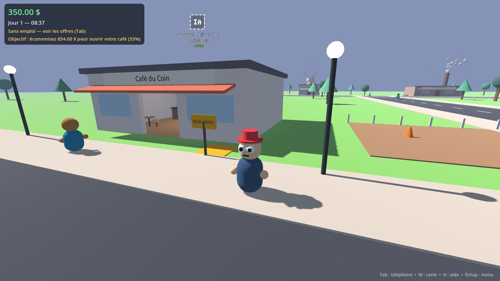
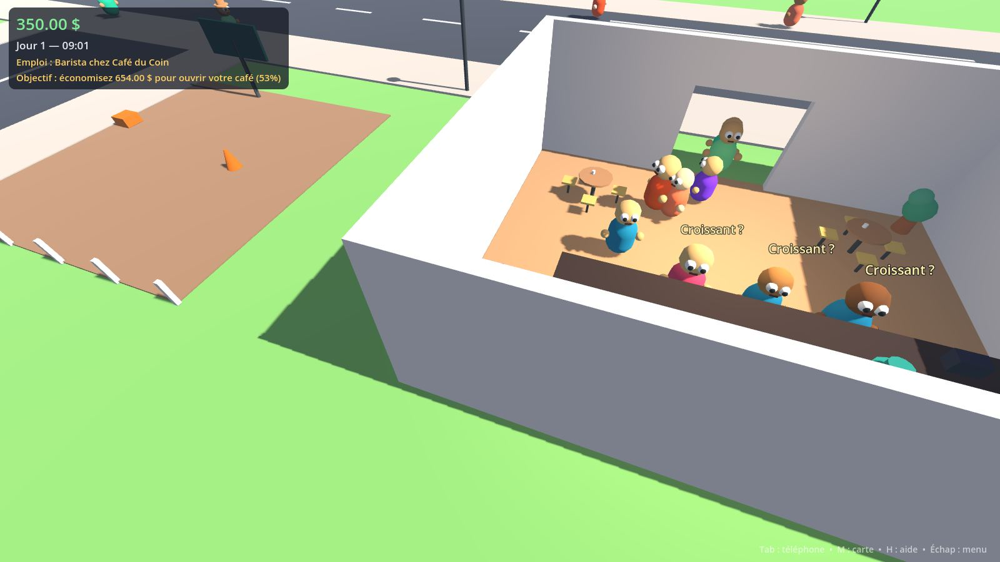
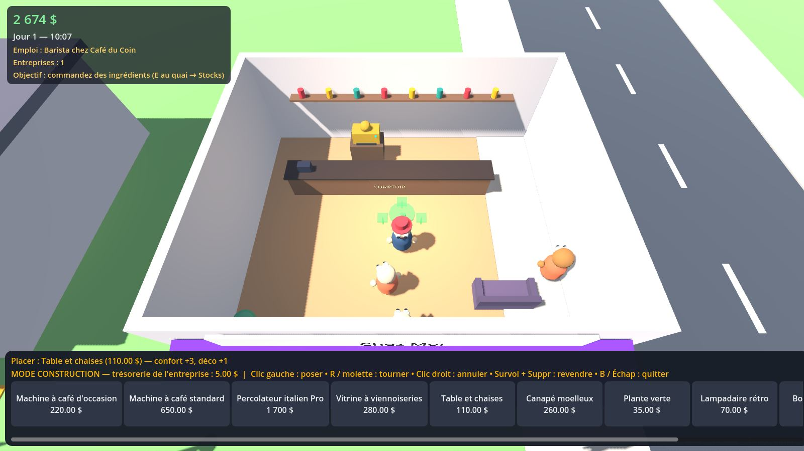
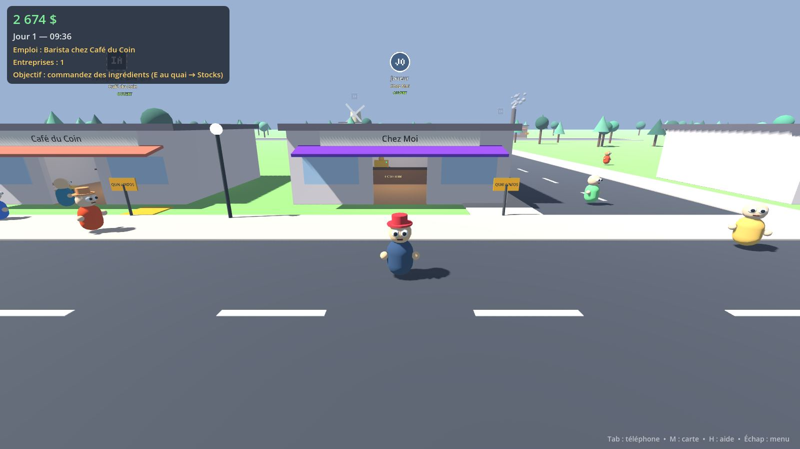
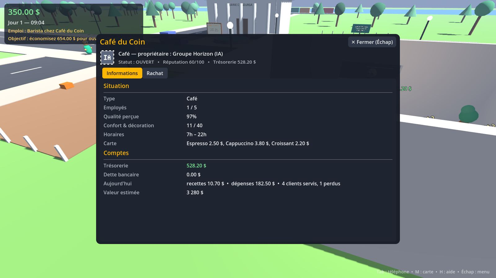

# Bourgade Inc.

Un monde ouvert 3D coloré où chacun choisit sa vie : salarié, livreur, cueilleur, patron de café, repreneur d'entreprises… dans une **économie partagée** où les produits circulent réellement entre fermes, usines et commerces, et où une **IA économique** fait tourner toutes les entreprises que les joueurs ne possèdent pas.

> **Version 0.1 — prototype jouable (Phase 1 + une bonne partie de la Phase 2).** Solo local. Le multijoueur et Steamworks sont préparés dans l'architecture mais **pas encore intégrés** (voir « Ce qui manque »).



| Service au comptoir (clients PNJ en direct) | Mode construction |
|---|---|
|  |  |
| **Votre café et son badge de propriétaire** | **Gestion d'entreprise** |
|  |  |

---

## 1. Lancer le jeu sur Windows

### Option A — version exécutable (le plus simple)
1. Téléchargez [`releases/BourgadeInc-Windows-v0.1.zip`](releases/BourgadeInc-Windows-v0.1.zip) (≈ 33 Mo).
2. Décompressez-le **entièrement** (le `.exe` et le `.pck` doivent rester dans le même dossier).
3. Double-cliquez sur `BourgadeInc.exe`.
   * Windows SmartScreen peut afficher « Windows a protégé votre ordinateur » (l'exécutable n'est pas signé) → *Informations complémentaires* → *Exécuter quand même*.
   * Carte graphique compatible OpenGL 3.3 requise (toute carte de moins de ~10 ans).

Les sauvegardes sont stockées dans `%APPDATA%\Godot\app_userdata\Bourgade Inc.\saves\`.

### Option B — depuis les sources (pour développer)
1. Téléchargez **Godot 4.4.1 « Standard »** (pas la version .NET) : <https://godotengine.org/download/archive/4.4.1-stable/> — un seul `.exe`, aucune installation.
2. Lancez Godot → *Importer* → sélectionnez `game/project.godot`.
3. Appuyez sur **F5** pour jouer.

### Recompiler l'exécutable Windows
Dans l'éditeur : *Projet → Exporter… → Windows Desktop → Exporter le projet* (installez les modèles d'export si Godot le demande).
En ligne de commande :
```bash
godot --headless --path game --export-release "Windows Desktop" ../build/windows/BourgadeInc.exe
```
Chaque `push` sur GitHub lance aussi le workflow `.github/workflows/build.yml` : tests automatiques + export Windows téléchargeable dans l'onglet *Actions* (artefact `BourgadeInc-Windows`).

### Lancer les tests automatiques
```bash
godot --headless --path game --editor --quit     # première fois : indexe les classes
godot --headless --path game -- --selftest       # 58 vérifications, code de sortie 0 = OK
```

---

## 2. Commandes

| Touche | Action |
|---|---|
| ZQSD / WASD (ou flèches) | Se déplacer (les touches s'adaptent au clavier AZERTY/QWERTY) |
| Souris / molette | Caméra / zoom |
| Maj · Espace | Courir · sauter |
| **E** | Interagir (le texte en bas de l'écran indique l'action possible) |
| R | Action secondaire (réparer une machine, infos entreprise) |
| F | Monter / descendre de l'utilitaire |
| G | Poser l'objet porté |
| **Tab** | Téléphone : emplois, mes entreprises, marché, registre, actualités, succès |
| M | Carte (clic = repère GPS) |
| B | Mode construction (dans un établissement que vous possédez) |
| F5 / F9 | Sauvegarder / charger |
| H · Échap | Aide · menu pause (pause du temps, temps ×3, pseudo) |

## 3. Premiers pas
1. **Travaillez** (Tab → Emplois) :
   * **Barista** au *Café du Coin* ou chez *Kawa Express* : au comptoir, E pour prendre un service. Un client affiche sa commande → machine à café (E) → appuyez sur **E dans la zone verte** pour une mousse parfaite (gros pourboire) → revenez au comptoir (E) pour servir. Croissants : vitrine.
   * **Livreur** : acceptez une commande entre deux entreprises, récupérez la caisse au quai du vendeur, livrez-la au quai de l'acheteur. Prenez l'utilitaire (F) pour aller plus vite. Une flèche bleue vous guide.
   * **Cueilleur** aux *Serres Caféières Bio* (à l'est) : cueillez les buissons aux cerises rouges.
2. **Économisez** ~650 $, puis **louez un terrain libre** (panneau vert) et construisez votre café.
3. **Équipez-le** : entrez, touche **B**, posez une machine (d'occasion pour commencer) et une vitrine. Faites un **apport** de trésorerie (onglet Finances).
4. **Approvisionnez-le** (E au quai → Stocks) : café torréfié, lait, croissants — chez les producteurs locaux ou au port (plus cher).
5. **Fixez vos prix, embauchez, décorez** (le confort attire les clients), lancez une pub… ou **rachetez un concurrent** (E au quai → Rachat).

---

## 4. Fonctionnalités opérationnelles (testées)

**Monde & personnage**
- Ville 3D procédurale : centre commerçant, mairie (offres d'emploi), zone industrielle (moulin animé, torréfaction fumante), campagne (serres, laiterie et ses vaches, ferme céréalière avec silo), port de commerce. Arbres, lampadaires, fontaine, passants.
- Personnage « wobbly » aux yeux globuleux contrôlable clavier/souris, caméra 3ᵉ personne, saut, course, cycle jour/nuit.
- Utilitaire de livraison conduisible (arcade), qui transporte une caisse.
- Interactions contextuelles (E/R), GPS avec flèche, carte cliquable, notifications, succès.

**Métiers jouables (avec un vrai gameplay)**
- **Barista** salarié ou patron : file d'attente de clients PNJ visibles, préparation à la machine avec mini-jeu de timing (qualité → pourboire), service au comptoir, croissants en vitrine.
- **Livreur / transporteur** : les vraies commandes entre entreprises deviennent des missions ; la marchandise n'arrive que si quelqu'un la livre (vous, ou un transporteur IA à défaut).
- **Ouvrier agricole** : cueillette qui alimente réellement le stock de la ferme.
- **Mécanicien de maintenance (léger)** : les machines s'usent ; réparation à la main (R devant la machine, 3 s) moins chère qu'un réparateur.
- **Entrepreneur / gérant** : tout le reste ci-dessous.

**Entreprises & économie**
- 8 entreprises IA en chaîne de production : ferme caféière → torréfaction → cafés ; laiterie → cafés & boulangerie ; ferme céréalière → moulin → boulangerie → cafés & clients. Le port importe ce qui manque (cher) et rachète les surplus (bon marché) : aucun secteur ne peut « mourir ».
- Stocks réels, capacités d'entrepôt, bons de commande, délais et frais de livraison, réapprovisionnement automatique avec seuils.
- Clients PNJ avec profils (pressé, gourmet, économe, touriste) qui choisissent l'établissement selon **prix, qualité, réputation, distance, attente, confort/décor, publicité, fidélité** ; ils renoncent si tout est trop cher.
- **Simulation à deux niveaux** : près du joueur, les clients et baristas sont animés ; loin, la même entreprise est simulée abstraitement avec les mêmes règles (performances).
- Prix dynamiques : l'IA ajuste ses prix selon ses stocks (pénurie ↑, surplus ↓), la concurrence et sa charge ; prix de référence du marché.
- **IA économique** : achète, produit, vend, embauche/licencie, répare, investit (agrandissement, nouvelle machine), s'endette, réduit ses coûts, met en vente une entreprise en difficulté (décote) ou parfois saine (prime). Aucune ressource infinie.
- **Créer** une entreprise : louer (caution + loyer) ou acheter un terrain, nom, couleur d'enseigne, construction animée.
- **Mode construction** : catalogue (3 machines dont une d'occasion, vitrine, tables, canapé, plantes, lampadaire, borne d'arcade jouable, juke-box) avec prix, vitesse, qualité, énergie, usure, confort/déco ; placer, tourner, déplacer, revendre ; collisions et bornes vérifiées.
- **Gestion** : aperçu & historique 7 jours (recettes, dépenses par poste, clients servis/perdus), conseiller de gestion, prix, stocks & commandes (choix du fournisseur, y compris d'autres joueurs), export au port, personnel (candidats du jour, compétences, salaires, licenciement avec indemnité), équipement, prêt bancaire / remboursement, apport / retrait, publicité, promotions, programme de fidélité, ouverture/fermeture, renommage, **Gérant IA** payant qui gère à votre place.
- **Rachat** d'entreprises IA : offre → acceptation, refus ou contre-proposition ; anti-spam (délai entre offres) ; le transfert inclut bâtiment, matériel, stock, trésorerie, dettes, employés et commandes. Vente de votre entreprise (mise en vente ou rachat immédiat par le groupe IA à 80 % de sa valeur).
- **Badges de propriétaire** au-dessus de chaque bâtiment : avatar (profil Steam plus tard, profil local de test aujourd'hui), pseudo, nom de l'entreprise, état (ouvert / fermé / à vendre / en difficulté). Les entreprises IA ont un badge carré gris distinct. Le badge se simplifie et s'estompe avec la distance.
- Comptes publics pour les entreprises IA, confidentiels pour les joueurs (sauf si à vendre).
- Événements économiques aléatoires (festival, récolte exceptionnelle, pénurie mondiale de café), gazette locale, bilan quotidien.
- **Sauvegarde locale** (F5/F9, automatique chaque jour, écriture via un fichier temporaire) et chargement complet du monde.

**Garanties techniques vérifiées par les tests** : conservation de la monnaie (aucune entreprise ne crée d'argent : tout flux vient du « reste du monde » — tourisme, export, énergie, impôts — ou de la banque via des prêts), validations côté « serveur » (propriété, fonds, limites), aller-retour sauvegarde/chargement, boucles de gameplay barista / livraison / cueillette / véhicule exécutées dans la vraie scène.

## 5. Ce qui manque (honnêtement)
- **Multijoueur** : pas encore de connexion réseau. L'architecture est prête (voir §7), mais rien n'est testé à plusieurs.
- **Steamworks** : non intégré (pas d'App ID). Le jeu utilise un **profil local de test** (pseudo modifiable, avatar généré). Le code détecte automatiquement GodotSteam s'il est installé, mais ce chemin n'a pas pu être testé.
- **Un seul type d'entreprise créable par le joueur** : le café. Fermes, moulin, torréfaction, laiterie et boulangerie sont **rachetables et gérables** (prix, stocks, personnel, agrandissement, export) mais n'ont pas encore d'intérieur jouable.
- Pas de son ni de musique.
- Graphismes 100 % procéduraux (primitives colorées), pas d'animations squelettiques.
- Pas de parts d'entreprise / associés, ni de contrats commerciaux longue durée, ni de négociation entre joueurs (les structures de données existent : `partners`, fournisseurs joueurs dans les commandes).
- Pas d'hôtels, garages, restaurants, etc. : voir la feuille de route.
- Les PNJ ne contournent pas les obstacles (trajets en ligne droite) ; le véhicule est arcade.

## 6. Problèmes connus
- L'équilibrage économique est un premier jet : un café mal équipé (machine d'occasion jamais réparée, aucun confort) perd de l'argent ; un café bien géré est rentable. Les valeurs sont toutes dans `game/data/*.json`.
- Les clients d'un café se dirigent tout droit vers le comptoir et peuvent traverser une table posée sur leur chemin.
- Recharger une partie relance le temps à l'heure sauvegardée mais les caisses portées sont rendues au transporteur IA (choix volontaire).
- L'export Windows a été produit avec les modèles officiels Godot 4.4.1 et le paquet `.pck` a été vérifié en l'exécutant (menu, partie, construction, panneaux…) sous Linux ; l'`.exe` lui-même **n'a pas pu être lancé sous Windows** dans mon environnement. Si un souci apparaît, l'option B (Godot + sources) fonctionne à coup sûr.

---

## 7. Architecture & choix techniques

**Moteur : Godot 4.4 (GDScript, renderer « Compatibility »/OpenGL 3.3).**
Comparé à Unity : prototypage plus rapide (projet texte, pas de licence ni de runtime fee), export Windows en une commande, multijoueur haut niveau intégré (`MultiplayerAPI`, ENet/WebRTC, RPC avec autorité serveur), intégration Steam mature via **GodotSteam** (GDExtension), légèreté adaptée aux PC de milieu de gamme. Unity aurait un écosystème d'assets plus riche, mais ce projet est construit pour être modulaire et data-driven, ce qui réduit ce besoin.

```
game/
  data/                    # TOUT le contenu est data-driven (JSON)
    goods.json             #   marchandises
    business_types.json    #   types d'entreprises (recettes, menu, horaires, salaires…)
    equipment.json         #   équipements (prix, vitesse, qualité, énergie, usure, confort…)
    world_layout.json      #   emplacement des entreprises et terrains
    balance.json           #   tous les réglages d'équilibrage
  scripts/
    core/                  # autoloads : GameData, Identity (profils/Steam), Clock, SaveSystem
    economy/               # simulation pure, sans nœuds 3D (exécutable sur serveur dédié)
      economy.gd           #   comptes, transferts, commandes, demande, rachats, emplois — API request_*
      business.gd          #   données + règles d'une entreprise
      business_ai.gd       #   stratégie de l'IA économique
    world/                 # représentation 3D : bâtiments, badges, terrains, équipements, caisses
    gameplay/              # service en direct d'un café, mode construction
    actors/                # joueur, PNJ, véhicule, visuels « wobbly »
    ui/                    # HUD, fenêtres de gestion, carte
  tests/self_test.gd       # tests de bout en bout (économie + scène + gameplay)
```

Principes clés :
- **Séparation monde / économie / joueurs / UI.** L'économie ne connaît aucun nœud 3D ; la scène se reconstruit à partir des données ; l'UI n'écrit jamais l'état elle-même.
- **Autorité serveur prête pour le multijoueur.** Toute action d'un joueur passe par une méthode `Economy.request_*` qui valide propriété, fonds, bornes et délais anti-abus. En réseau, seul l'hôte exécutera ces méthodes (les clients enverront une RPC) ; la monnaie n'est jamais calculée côté client.
- **Comptabilité à somme nulle** : chaque solde vit dans `Economy.accounts` et ne bouge que par `transfer()`. Les tests vérifient que la somme reste 0 (anti-« création d'argent »).
- **Simulation LOD** : entreprises proches = PNJ animés ; éloignées = calcul horaire abstrait identique.
- **Identité abstraite** : le jeu ne parle qu'à `Identity` (`get_profile`, `get_avatar`). Fournisseur `local` aujourd'hui ; `steam` activé automatiquement si GodotSteam est présent (pseudo, SteamID, avatar moyen ; seules des données publiques de profil sont utilisées, conformément aux règles de Steam).

**Ajouter du contenu sans réécrire le jeu** : une nouvelle marchandise = une entrée dans `goods.json` ; une nouvelle filière = un type dans `business_types.json` (recette `inputs/outputs`, ou `menu` pour la vente au détail) + une entrée dans `world_layout.json` ; un nouvel équipement = une entrée dans `equipment.json` (un visuel générique est utilisé tant qu'aucun modèle dédié n'existe).

## 8. Feuille de route proposée
- **0.2 – Multijoueur LAN/amis** : hôte autoritaire (ENet), synchronisation des entreprises/bâtiments/badges, RPC `request_*`, chat simple ; puis lobbies et invitations Steam (GodotSteam), avatars Steam.
- **0.3 – Deuxième filière jouable : garage** (diagnostic de pannes, pièces détachées, file de véhicules PNJ) + fabricant de pièces → chaîne automobile.
- **0.4 – Contrats commerciaux** (volume/prix/durée, exclusivité), parts d'entreprise et associés, négociation entre joueurs, protections contre les transferts abusifs (plafonds, délais, journal d'audit).
- **0.5 – Hôtellerie & loisirs** (hôtel avec réservations et ménage, bowling, karting), touristes qui séjournent.
- **Ensuite** : construction libre de bâtiments, livraisons multi-caisses, PNJ avec trajets quotidiens, sons & musique, modèles 3D définitifs, optimisation pour 8–16 joueurs, préparation de la page Steam.

### Idées ajoutées par rapport au cahier des charges
- **Mini-jeu de timing** du barista : la qualité du geste devient un pourboire et de la réputation, pas un simple clic.
- **Les commandes inter-entreprises deviennent des missions de livraison** : la logistique est à la fois un système économique et un métier jouable.
- **Port « tampon »** : importe ce qui manque et rachète les surplus — empêche qu'une filière meure faute de joueurs, tout en restant plus cher qu'un fournisseur local.
- **Réputation qui suit la satisfaction récente** (pas d'accumulation infinie) : un leader peut être rattrapé, ce qui évite les monopoles permanents.
- **Gérant IA payant** et **rachat immédiat par le groupe IA** : automatisation et liquidité, avec un coût.
- **Objectif guidé** dans le HUD (de salarié à entrepreneur), jamais bloquant.
